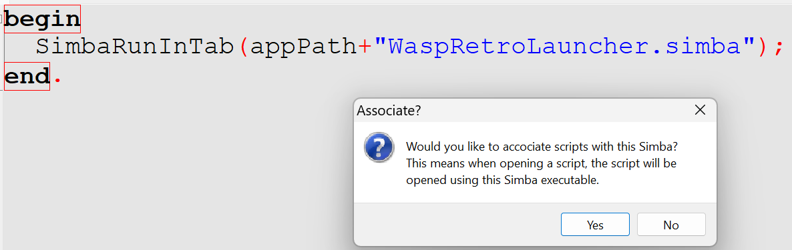
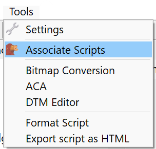
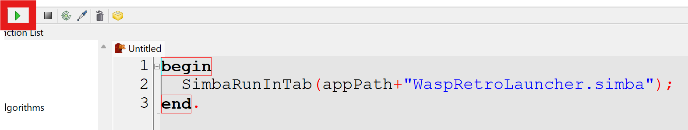
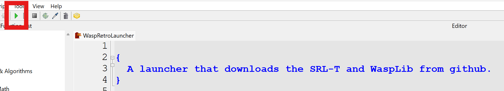
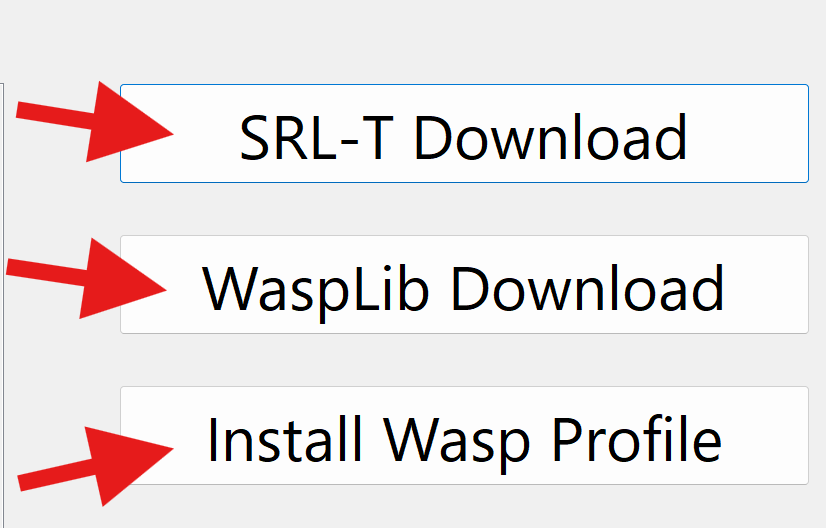
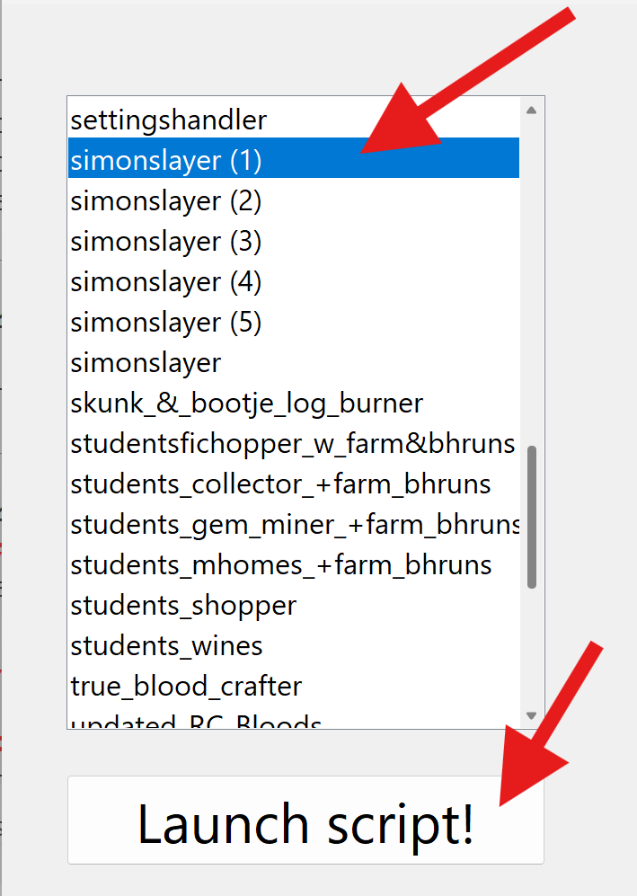

# 🐝 WaspRetro

Welcome to **WaspRetro** — a continuation of Simba with support for **WaspLib** and **SRL-T**.

### Get started

1. **Download** the [latest WaspRetro ZIP](https://github.com/SimonK4/WaspRetro/archive/refs/heads/master.zip).
2. **Extract** it to your desktop. The folder can be called anything, though `WaspRetro` keeps things tidy.
3. **Launch Simba** by opening `Simba64.exe` inside the extracted folder.
4. If Simba asks to associate scripts with the program, choose **Accept**.

   
   
   If you have multiple simbas installed you'll need to manually trigger the association. 
   

5. **Open the Simba64.exe** 

   First, press **Play** to open the launcher code:

   

   Then press **Play** again to run the launcher:

   
   
6. **Install the essentials:** SRL-T, WaspLib, and WaspProfile.

   
7. **Choose a script** from the left-hand list and click **Launch Script!**

   

Happy scripting!